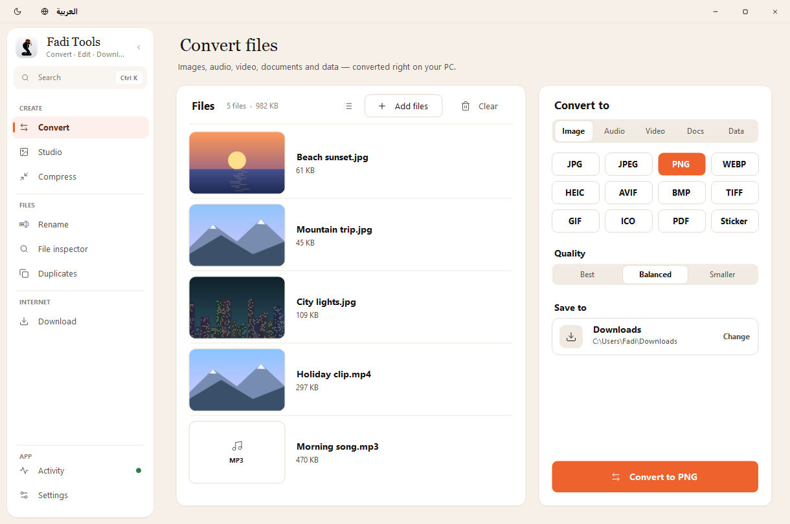
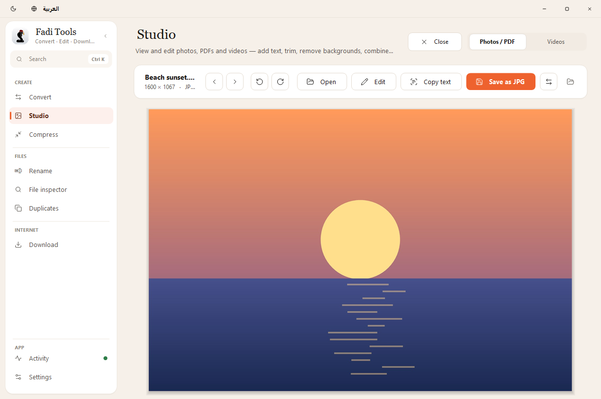
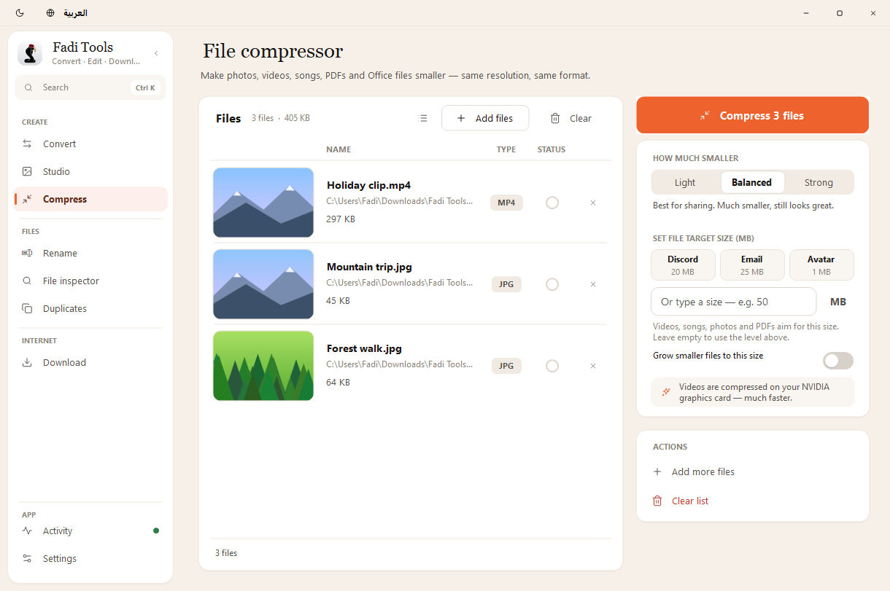
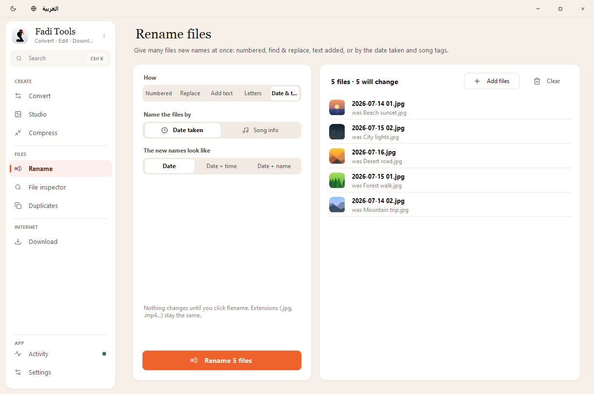
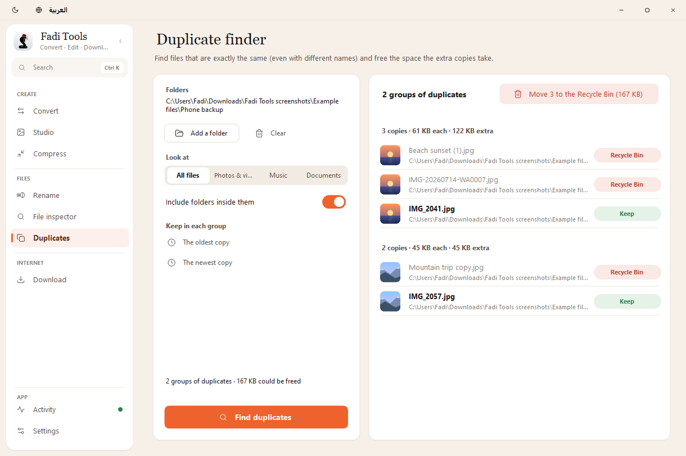
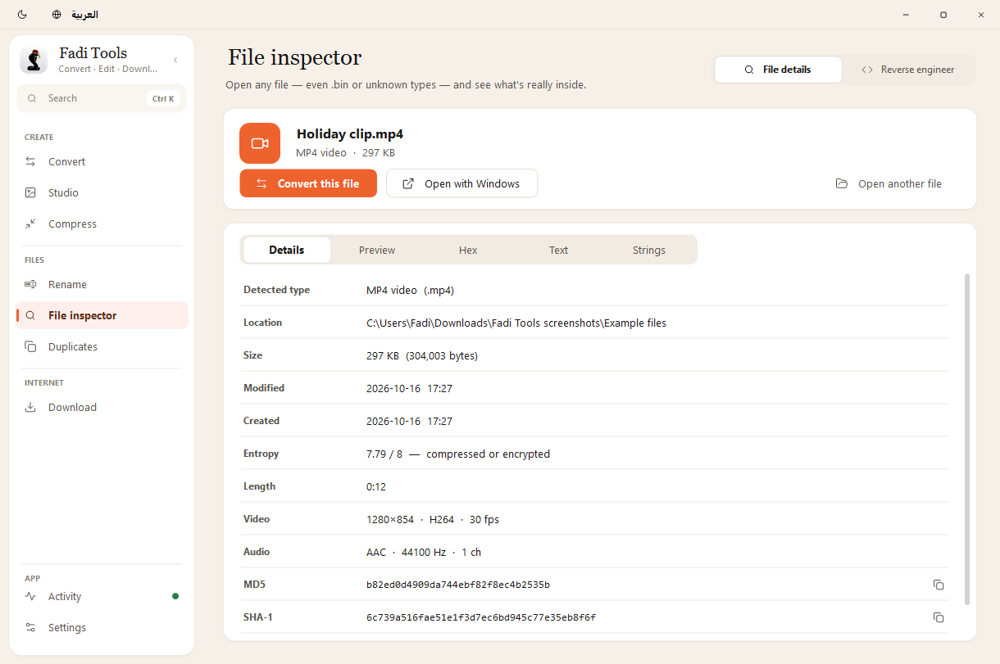
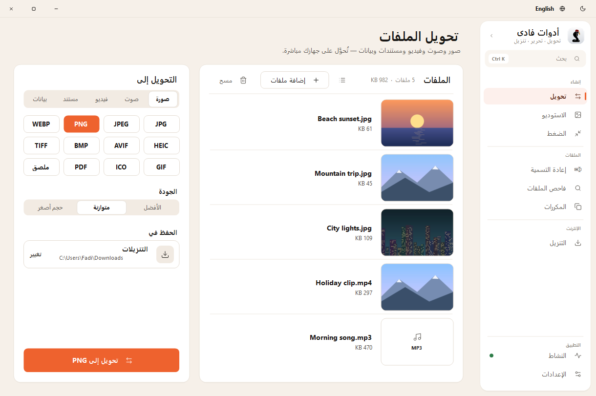

# Fadi Tools

**All-in-one Windows app — Convert, Compress, Edit and Download Files. Free, offline, in English and Arabic.**

### [⬇ Download the latest version](https://github.com/RockeyUS/Fadi-Tools/releases/latest)

Get **Fadi.Tools.zip** (everything included), unzip it anywhere and open **Fadi Tools.exe**. Or get **Fadi.Tools.exe** on its own; it downloads its engines the first time.
If Windows says "Windows protected your PC", It's due to Unsigned code, click **More info → Run anyway**.

<picture>
  <source media="(prefers-color-scheme: dark)" srcset="https://raw.githubusercontent.com/RockeyUS/Fadi-Tools/main/screenshots/convert-dark-en.png">
  
</picture>

## What it does

- **Convert** pictures, audio, video, documents and data files
- **Compress** videos and pictures, with one-click sizes for Discord, Email and profile pictures
- **Studio** — edit photos and videos (text, photos on top, rotate, remove backgrounds, trim, transitions, music, auto captions) and PDFs (add text and pictures, combine, reorder, rotate, sign, number, watermark, lock, split, save pages as pictures)
- **Copy text from pictures** and **make scanned PDFs searchable** (Arabic and English)
- **Rename** many files at once — numbered, find & replace, or by the date a photo was taken and a song's tags — with undo
- **Find duplicate files** and move the extra copies to the Recycle Bin
- **Download** from YouTube and 1,000+ sites — or just copy a link and it offers to
- **File inspector**, with **Reverse engineer** inside it, for the curious
- Keeps working by the clock when you close the window mid-job, works with the keyboard and screen readers, and stays sharp on every screen

## Requirements

Windows 10 or 11. The app updates itself when a new version comes out.

## Screenshots

<picture>
  <source media="(prefers-color-scheme: dark)" srcset="https://raw.githubusercontent.com/RockeyUS/Fadi-Tools/main/screenshots/studio-dark-en.png">
  
</picture>

<picture>
  <source media="(prefers-color-scheme: dark)" srcset="https://raw.githubusercontent.com/RockeyUS/Fadi-Tools/main/screenshots/compress-dark-en.png">
  
</picture>

<picture>
  <source media="(prefers-color-scheme: dark)" srcset="https://raw.githubusercontent.com/RockeyUS/Fadi-Tools/main/screenshots/rename-dark-en.png">
  
</picture>

<picture>
  <source media="(prefers-color-scheme: dark)" srcset="https://raw.githubusercontent.com/RockeyUS/Fadi-Tools/main/screenshots/duplicates-dark-en.png">
  
</picture>

<picture>
  <source media="(prefers-color-scheme: dark)" srcset="https://raw.githubusercontent.com/RockeyUS/Fadi-Tools/main/screenshots/inspector-dark-en.png">
  
</picture>

**بالعربية** — the whole app is also in Arabic, right to left:

<picture>
  <source media="(prefers-color-scheme: dark)" srcset="https://raw.githubusercontent.com/RockeyUS/Fadi-Tools/main/screenshots/convert-dark-ar.png">
  
</picture>

More pictures (every page, light and dark, English and Arabic) are in the [screenshots](screenshots) folder. They're made by the app itself: press **Ctrl+Alt+Shift+S** and it saves a fresh set, with made-up example files, to *Downloads › Fadi Tools screenshots*.
